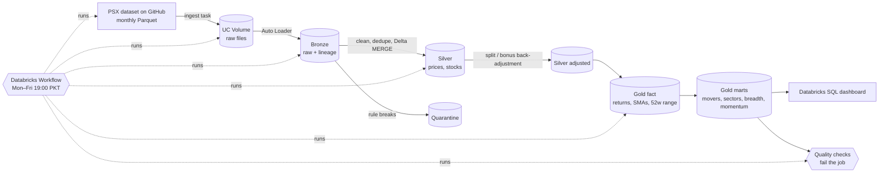

# PSX Lakehouse on Databricks

**A medallion lakehouse for 10 years of Pakistan Stock Exchange prices, built with PySpark, Delta Lake, Unity Catalog, Auto Loader and Databricks Workflows.**

It takes the daily end-of-day dataset published by [psx-market-data-platform](https://github.com/shessols/psx-market-data-platform) (677 stocks, 917,000+ rows, Nov 2016 – today) and turns it into clean, adjusted, analysis-ready Delta tables, refreshed every trading day.




## What it shows

| Area | How | Where |
|---|---|---|
| Ingestion | Incremental download to a Unity Catalog volume (only new + last 2 months) | `src/psx_lakehouse/ingest.py` |
| Streaming ingestion | Auto Loader (`cloudFiles`), schema tracking, `availableNow` trigger, checkpoints | `pipeline.bronze_autoloader` |
| Lakehouse | Delta Lake, bronze / silver / gold, liquid clustering, `OPTIMIZE`, time travel | `pipeline.py` |
| Upserts | Delta `MERGE` keyed on stock + day, newest load wins | `DeltaStore.upsert` |
| Data quality | Rule-based quarantine table, job-failing checks, `quality_log` history | `transforms.quality_flags`, `05_quality_checks.py` |
| PySpark | Window functions (lag, rolling averages, ranks), log-sum cumulative products for split adjustment | `src/psx_lakehouse/transforms.py` |
| Orchestration | Databricks Asset Bundle: 6-task job with retries, schedule, parameters | `databricks.yml`, `resources/psx_job.yml` |
| Analytics | SQL for a Databricks dashboard: breadth, movers, sector heatmap, momentum | `sql/dashboard_queries.sql` |
| Engineering | Pure transforms tested with pytest on local Spark; CI on every push | `tests/`, `.github/workflows/ci.yml` |

## Tables (`workspace.psx`)

| Layer | Table | Grain | What's in it |
|---|---|---|---|
| Bronze | `bronze_daily_prices` | file row | Raw prices + `_source_file`, `_ingested_at` |
| Bronze | `bronze_stocks` | stock | Symbol, name, sector |
| Silver | `silver_daily_prices` | stock-day | Typed, de-duplicated, valid rows only |
| Silver | `silver_quarantine` | stock-day | Rows that broke a rule, with `_dq_issue` |
| Silver | `silver_adjusted_prices` | stock-day | Prices back-adjusted for splits and bonus shares |
| Silver | `silver_corporate_actions` | event | Days where the move broke PSX's price limit |
| Gold | `gold_fct_daily_prices` | stock-day | % change, value traded, SMA 20/50/200, 52-week high/low, liquidity flag |
| Gold | `gold_daily_movers` | stock-day | Top 5 losers and gainers among liquid stocks |
| Gold | `gold_sector_daily` | sector-day | Advancers, decliners, average move, value traded |
| Gold | `gold_market_breadth` | day | Breadth ratio, new 52-week highs and lows |
| Gold | `gold_momentum_monthly` | month | Top-10 12-month momentum basket vs the market, next-month returns |
| Gold | `gold_strategy_summary` | strategy | Annual return and worst drawdown |
| Ops | `quality_log` | check × run | Every check result, every run |

## Results on the real data (run on 16 Nov 2026)

- **917,810** raw rows in, **915,700** clean stock-days out, **2,110** quarantined (zero or negative prices), **0** duplicates.
- **1,441** corporate-action days detected and back-adjusted.
- Monthly research on every liquid PSX stock (Nov 2017 – Oct 2026, fees and tax not included):

| Strategy | Per year | Worst drop |
|---|---|---|
| Market, equal weight | 16.0% | −50% |
| Momentum: top 10 by 12-month return | 10.7% | −62% |

Across all liquid stocks, plain momentum lagged the market, with bigger crashes. On KSE-100 stocks with a trend filter, the sister project found the opposite (about 21% a year). The universe you pick changes the answer. Not investment advice.

## Run it on Databricks (Free Edition works)

1. Sign up for [Databricks Free Edition](https://www.databricks.com/learn/free-edition). Free Edition limits outbound internet to a few trusted sites, so the `ingest` task needs the **Verify with LinkedIn** upgrade in your account, which unlocks outbound internet. Without it, upload `dataset/prices/*.parquet` and `dataset/stocks.csv` from the source repo to the `raw` volume (`prices/` and `stocks/`) and remove the `ingest` task.
2. Install the [Databricks CLI](https://docs.databricks.com/aws/en/dev-tools/cli/install), then `databricks auth login --host <your-workspace-url>`.
3. From this folder:
   ```bash
   databricks bundle validate
   databricks bundle deploy
   databricks bundle run psx_lakehouse_daily
   ```
4. Open **Workflows → psx-lakehouse-daily** to watch the 6 tasks, and **Catalog → workspace → psx** for the tables.
5. Optional: build a dashboard from `sql/dashboard_queries.sql`.

No CLI? Use **Workspace → Create → Git folder**, paste this repo's URL, and run the notebooks `00` to `05` in order.

## Run it on your laptop

Needs Java 17+ and Python 3.10+. Uses plain Spark and Parquet instead of Delta, with the same transforms.

```bash
pip install -r requirements-dev.txt
pytest -q tests                 # 6 tests
python scripts/run_local.py     # full pipeline on the real data, about a minute
```

## Data

End-of-day prices from the PSX Data Portal (dps.psx.com.pk), collected by [psx-market-data-platform](https://github.com/shessols/psx-market-data-platform) with the open-source [psxdata](https://pypi.org/project/psxdata/) library, for education and research. PSX market data belongs to PSX. Only currently listed companies are included, so research results carry survivorship bias.

Built by **Abdullah Sherwani**, Data Analyst & Data Engineer · [LinkedIn](https://linkedin.com/in/shessols) · MIT License
